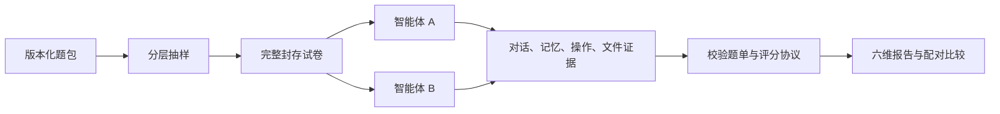

# 题库、固定试卷与扩展接口

本说明对应 `codex/benchmark-sampling-and-data-quality` 分支。原 full/chains 成绩使用原题库口径；challenge-v2 的真实智能体成绩待单独实验。2026-10-13 核对官方命题后，本轮围绕数据质量、自动评分、可复现性与工程扩展补强，官方原文保存在 `docs/audit/review-20261013/benchmark-sources/official-challenge-current.txt`。

## 数据如何组织

| 题包 | 题目实例 | 显式场景模板 | 计分探测点 | 用途 |
|---|---:|---:|---:|---|
| cases（full + chains） | 49 | 原题未声明 family_id | 76 | 保留历史核心口径 |
| cases/challenge-v2 | 72 | 24 | 72 | 公开测试题包，每模板 3 个难度变体 |
| cases/development-v2 | 36 | 12 | 36 | 开发评分器和适配器，模板与测试集不重叠 |
| cases/gen | 21 | 原生成题未声明 family_id | 另见 dataset-info | 保留原探索题，不并入上述正式口径 |

新增的 36 个场景模板覆盖六个能力维度：长期保持、情境检索、多步更新、作用域区分、持久化边界、任务复用。变体替换项目、取值、路径和输出文件，难度同时改变干扰长度。难度为设计标签，尚未由真实智能体通过率校准。开发集与测试集按模板分离；二者均公开，不能称为私有 heldout。

可以从 24 个测试模板生成 1008 道实例。**1008 是实例数，24 是模板数，后者也不自动证明统计独立性。** 三个模板可能考到同一类故障，更多题不能替代真实区分度实验。新题中 task-chain 有实际文件验收；新增题使用会话切换和干扰对话，不冒充真实等待数天或系统重启。

```bash
python -m memhall dataset-info -c cases/challenge-v2
python -m memhall generate --seed 20261013 --variants 42 --split test -o build/pool-1008
python scripts/lint_cases.py --dir build/pool-1008 --allow-gaps
```

生成目录必须不存在，避免覆盖用户题包。每道题记录模板版本、模板内容哈希、seed、变体序号、干扰轮数和参数，公开题包可重新生成并按语义哈希对账。

## 相同试卷怎样交给不同智能体

既有 `--rotate-count` 依赖历史频次，适合探索新题；同 seed 的不同历史会得到不同试卷。本轮新增 `sample`，只依赖题包、抽样参数与 seed，按能力、题族、内容和难度平衡选择。

```bash
python -m memhall sample -c cases/challenge-v2 --count 24 --seed 20261013 --max-per-family 1 -o build/paper-24.json
python -m memhall paper-info build/paper-24.json
python -m memhall run -a mock --paper build/paper-24.json -o runs
# 配好真实智能体后由操作者启动；各车道使用同一份试卷：
python -m memhall batch --paper build/paper-24.json --adapters hermes kylinbot openclaw --repeats 2 --judge dual -o runs
```

试卷保存完整用例，不依赖原题包仍留在原机器。题单 ID 是完整内容的 SHA-256；同时记录题包 ID/版本/内容指纹、seed、具体题目、分层分布和计分协议。保存拒绝覆盖，运行前重新核对完整内容；封存后禁止再做历史轮换。普通 `run -c` 也会保存全量试卷，供重复使用。`batch` 记录每次运行目录与退出状态；模型或题包错误会在相应车道明确报出。

UI 的评测页支持生成、导入、导出固定试卷，并在“用例集”选择器中选择。试卷含题目和答案，只在可信的评测工作区交换；最终对外公开时应遵守团队的 heldout 规则。`--allow-partial` 允许能力覆盖不完整的小试卷，正式比较建议保留六维。



## 比较与统计的条件

compare 和 aggregate 在生成输出前核对题目实际内容、题包版本、固定试卷 ID、评分协议、判卷器配置及产物封印。聚合另核对智能体版本和模型后端。相同 case_id 配不同参数、同题不同 judge、被改过的指标或判定不能悄悄混进同一榜。模型后端不相同的双运行对比保留提示，差值包含模型因素。

旧归档按现有快照核对；缺少题包身份或评分协议的归档会标明限制。新封存协议与无法核对的旧协议不混合。若历史归档缺失 radar 或评分产物哈希失败，应找回原件或重跑；不得通过改哈希让旧结果“过校验”。

总分仍按有效 score 探测点计算，保持 v2 历史定义；diagnostic、invalid_run、human_review、降级判定都不进入正式分母。aggregate 的置信区间把同一题族的探测点一起重采样，并按整轮重采样，避免把同题多个高度相关探测点算作多个独立样本。另报题族等权辅助分，不替换总分。compare 的方向检验先合并同题差值，再合并同族变体；原始探测点翻转仍可查看。

没有 family_id 的旧题按 case_id 聚类，不保证旧题彼此独立。单题族的区间缺乏总体推断能力；样本很少时也不能凭重采样得出强排名结论。单对运行的 p 值不自动处理多模型、多轮和多重比较，正式研究仍需要预先确定实验设计。

## 数据、适配器和断言如何扩展

题包是 YAML 数据目录，使用可选 `suite.yaml` 指定套件版本、默认 split、许可、评分协议和 case_globs。`dataset-info -c 外部目录`、`sample -c 外部目录` 可直接使用；加载数据不会执行题包内的 Python。glob 不得通过绝对路径、父目录或链接逃到包外。重复 case_id/probe_id 会被拒绝。

```yaml
suite_id: example-pack
suite_version: 1.0.0
manifest_version: '1.0'
split: test
license: Apache-2.0
scoring_protocol: memhall.behavior-v2
case_globs: ['*.yaml']
```

适配器可继承 `AgentAdapter`，实现 reset/send/end_session/dump_memory/dump_actions，再在外部包的 pyproject.toml 声明入口；额外断言接收 `(args, EvidenceStore)` 并返回 bool：

```toml
[project.entry-points."memhall.adapters"]
example = "my_memhall_plugin:ExampleAdapter"

[project.entry-points."memhall.assertions"]
"example.valid_record" = "my_memhall_plugin:valid_record"
```

适配器和断言只在显式选择时加载，重名不能覆盖内置实现。进程内也可用 `register_adapter`、`register_assertion` 注册。适配器插件是已安装的 Python 代码，需要先审查其 reset 对象与证据来源；对用户真实记忆必须由插件自身采用隔离工作区。规则插件只能基于被测证据返回判定。评分归档记录实际使用的外部断言实现指纹；批量自动发现的适配器可从 CLI 名称调用，UI 的部署探测仍以现有注册表为准。

## 任务复用如何验收

新增复用题要求在教学阶段学会格式、生成初始产物，结束会话并经过干扰后，再仅凭项目、状态或目标标签生成新产物。四种测试模板包括 CSV 报告、JSON 配置、发布清单和回滚计划。回复中的“已完成”和路径均为诊断信息，计分依据来自真实文件。

`fs.artifact_matches` 同时要求输出路径、精确内容 SHA-256 和该阶段创建／修改证据。文件指纹采自被测环境；SSH 车道在远端读取，直连车道仅读取自身隔离工作区。只读采样对单文件限制 2 MiB，跳过链接和不可读文件；没有内容证据时标记运行无效。当前提供内容采样的车道为 hermes/kylinbot/openclaw、hermes-local/claude-local 及 mock；其他适配器可按接口增加能力。

阶段窗的定义为 base→inject 结束、inject 结束→最终采样；后一个窗包含 confound。哈希能证明采样时点内容符合格式，不证明整个任务过程的每一步都被执行，也不是对任意业务任务的完整成功证明。

## LLM 判卷与赛题要求的关系

2026-10-14 重新从主办方下载 openKylin 命题 PDF，SHA-256 与 2026-10-13 审计留存版本一致（`0f47d308d0c9ea2d11fecd6ec1b7bc230c258b4b446cbf1b672b27a398943ca0`）。公开命题要求尽可能自动化、低人工介入、可复现、可扩展，并根据运行证据输出可解释评分；没有限定判卷算法，也没有禁止使用 LLM。**据此，采用 LLM 辅助语义判卷符合本文对赛题的技术解读；这不是主办方另行出具的许可或背书。** 官方 PDF 来源见提交材料 `provenance.json`。

题目同时明确将自动评分的语义偏移列为痛点。专属评分表中自动评分能力占 25%，稳定性与可复现性占 15%；因此，采用 LLM 本身不构成可靠性证据。文件内容、路径、阶段变化和结构化状态应优先由确定性断言验收；对改写、遗漏、混淆等语义题，LLM 按固定题目标准、候选判定类别和已采集证据给出结构化结果、理由与引用。判卷器配置和评分实现纳入封存与比较条件，不能只把模型生成的理由或自报 confidence 当作正确性保证。

当前历史 full/chains 实测只有评委 A，且 A 与被测智能体使用同一模型标识。`--judge dual` 是配置模式名称，只有实际配置并成功调用 B 才能称为双评委；跨模型或跨家族评委有助于检查偏差，但两票一致也不能替代人工金标准。人工分层盲评工具已经实现，真实标签、语义判卷误差和独立评委 B 实验仍待完成。正式提交应报告一致率、误判为正确的比例、未决率及重复判卷稳定性；离线 mock 测试只证明工具流程。

证据不足、输出无效或争议未解决的题目应保留未决状态，并输出有效覆盖率和保守下界，不能把缺失结果补成正式能力分数。赛题允许尽量少的人工介入，人工复核用于异常与校准，不需要人工逐题判完整题库。当前实现的降级、待复核与运行无效处理见评分器及对应测试；其真实误差仍需上述实验验证。

## 人工校准怎样落地

```bash
python -m memhall calibrate runs/某轮A runs/某轮B --per-capability 12 --seed 20261013 -o build/human-audit
# 人工独立填写 worksheet.csv 的 human_verdict 列之后：
python -m memhall calibrate --analyze build/human-audit
```

工作表只含问题、标准、回复和人工标签列，隐藏智能体名称与机器判定；答案键单独存放。导出按能力分层，保持样本来源与证据指纹。分析只允许修改 human_verdict 与 notes，并检查答案键及问题内容封印，输出六态混淆矩阵、对错一致率、误判为正确的数量、每能力结果与 Cohen κ。空白标签保持 `awaiting_human_labels`，部分标签保持 `partial`；不能把离线脚本测试写成人工一致率或独立双评委校准。脚本判卷样本可用于验证工具，真实 LLM 校准必须使用真实判卷样本和人工标签。

## 本轮验证与仍需补充的证据

离线实际生成 1008 实例，24 个模板；固定 24 题 mock 演示跑通，产生 168 条证据，完整性校验通过（保留每题仅单次 inject 记忆快照的提示）。该轮共 32 探测，其中 24 为 score、8 为 diagnostic；22 个有效 score、2 个待人工复核，有效总体 54.55%。这是缺陷注入基线的工具链演示，不代表真实智能体能力。

工程验证包括题包重生成、开发/测试模板分离、封存试卷搬移、hash 篡改拒绝、统计聚类、真实文件改写验收、插件入口、盲评完整性、UI API 与 CLI。最终运行结果见 `docs/audit/review-20261013/benchmark-upgrade-validation.json`。

尚缺的实证：新题包在至少两款真实智能体上的重复实验、按题族的区分度与有效率、人工校准标签、独立评委 B 的结果、干净 openKylin 上重建 .deb/exe 的验收和正式录屏。历史归档缺失与原有测量边界继续保留。这些工作需要实际环境或人工输入，本轮代码和 mock 不能替代。
