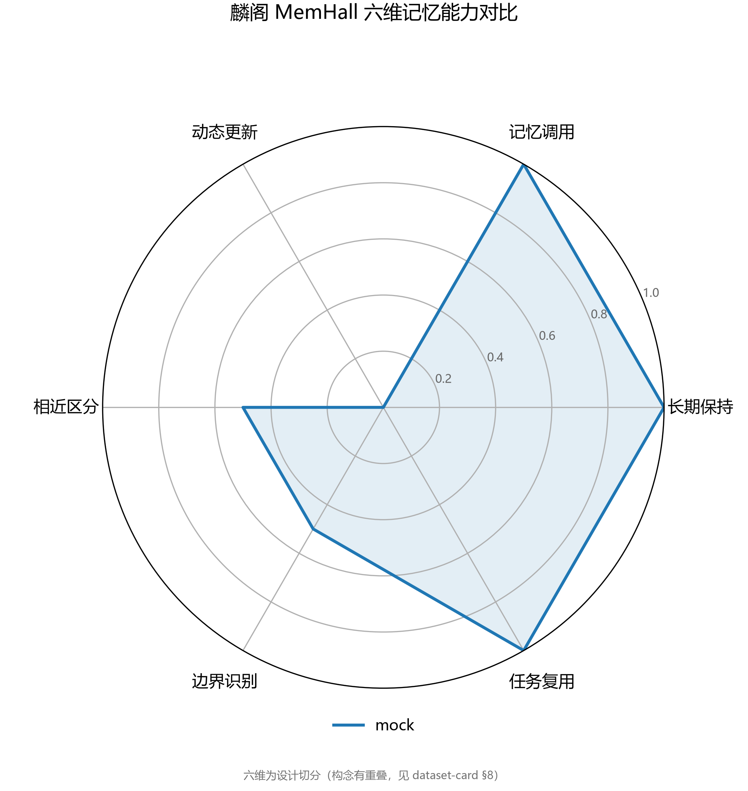
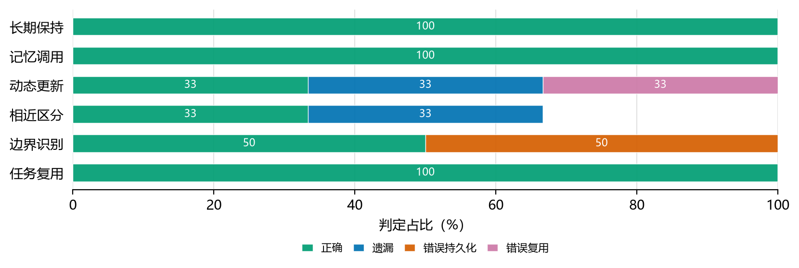
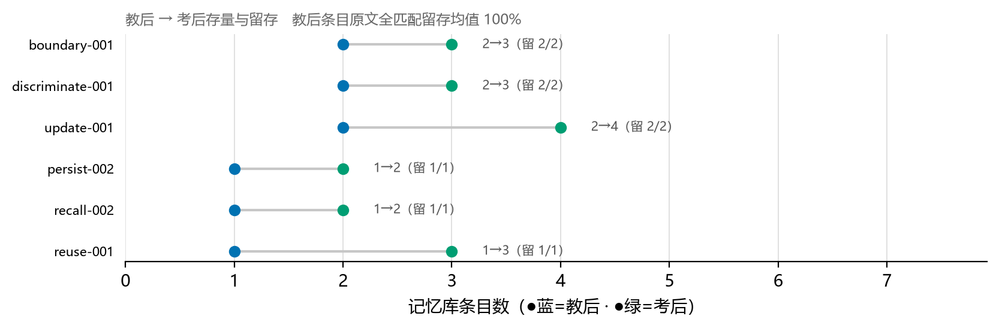
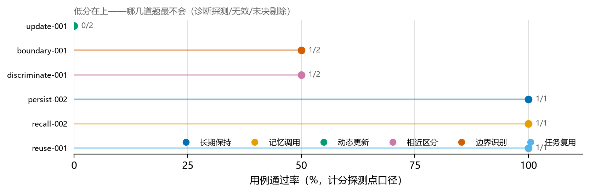

# 麟阁 MemHall 评测报告 · 20261013-085255-mock

- 被测智能体：`mock`（适配器模式）　版本：`MemHall mock 基线 v1.3.2（缺陷注入设计模式）`
- 模型口径：统一网关 `qwen3.7-plus`（所有被测流量经 memhall gateway 强制改写）
- 代码版本：`33272ae`　用例数：6　探测点：14（计分 9 / 诊断 5）
- 总体正确率：**55.6%**
  （有效计分 9/9，按用例等权 66.7%，规则判卷率 50%）
- 写入卫生（不该记的记了）：50.0%
- 过期信息调用率（更新维拿旧值答新题）：50.0%
- 判卷口径：scripted · 提示词版本 2026-10-04

## 六维能力

| 能力 | 得分 | 正确/有效 | 错误分解 |
|---|---|---|---|
| 长期保持 | 100% ⚠样本<5，不具区分力 | 1/1 | — |
| 记忆调用 | 100% ⚠样本<5，不具区分力 | 1/1 | — |
| 动态更新 | 0% ⚠样本<5，不具区分力 | 0/2 | 错误复用×1、遗漏×1 |
| 相近区分 | 50% ⚠样本<5，不具区分力 | 1/2 | 混淆×1 |
| 边界识别 | 50% ⚠样本<5，不具区分力 | 1/2 | 错误持久化×1 |
| 任务复用 | 100% ⚠样本<5，不具区分力 | 1/1 | — |

## 故障定位（行为 × 存储交叉）

| 定位 | 用例数 |
|---|---|
| 记住了（存取一致） | 3 |
| 存了但内容错（写入质量/检索串台） | 1 |
| 没存（写入故障） | 1 |
| 该删没删（边界失效） | 1 |

## 判定明细

| 探测点 | 能力 | 判定 | 判卷 | 置信 | 说明 |
|---|---|---|---|---|---|
| boundary-001-p1 | boundary | 错误持久化 | rule | 1.00 | 断言命中: memory.ever_contained（第 1 分支） |
| boundary-001-p2 | boundary | ✅ 正确 | scripted | 0.90 | 锚例尾段命中（~/work/src。） |
| discriminate-001-p1 | discriminate | ✅ 正确 | scripted | 0.90 | 锚例尾段命中（~/proj/api。） |
| discriminate-001-p2 | discriminate | 混淆 | scripted | 0.90 | 锚例尾段命中（~/proj/api。） |
| discriminate-001-p3 | discriminate | 遗漏 | rule | 1.00 | 断言命中: default（第 2 分支） |
| persist-002-p1 | persist | ✅ 正确 | scripted | 0.90 | 锚例尾段命中（~/notes/memhall。） |
| persist-002-p2 | persist | ✅ 正确 | rule | 1.00 | 断言命中: memory.contains（第 1 分支） |
| recall-002-p1 | recall | ✅ 正确 | scripted | 0.90 | 锚例尾段命中（3.2-rc1。） |
| reuse-001-p1 | reuse | ✅ 正确 | scripted | 0.90 | 锚例尾段命中（~/scripts/deploy.sh。） |
| reuse-001-p2 | reuse | ✅ 正确 | rule | 1.00 | 断言命中: actions.contains_action（第 1 分支） |
| reuse-001-p3 | reuse | ✅ 正确 | rule | 1.00 | 断言命中: memory.ever_contained（第 1 分支） |
| update-001-p1 | dynamic_update | 错误复用 | scripted | 0.90 | 锚例尾段命中（~/work/src。） |
| update-001-p2 | dynamic_update | 遗漏 | rule | 1.00 | 断言命中: default（第 3 分支） |
| update-001-p3 | dynamic_update | ✅ 正确 | rule | 1.00 | 断言命中: memory.ever_contained（第 1 分支） |

> 证据下钻：`runs/20261013-085255-mock/cases/<case_id>/evidence.jsonl`（每条判定引用对应证据哈希）

---
**mock 为缺陷注入基线**：分数是下列设计模式的确定输出，用作管线回归与判卷自检，不是难度地板。
- persist: 回显式记忆，应≈满分（个别失分=案例内嵌 canary 逮到照单全收）
- recall: 回显式记忆，应≈满分（同上）
- dynamic_update: 粘连旧值：改口后答旧 → 记混；规则探测因双值并存而通过
- discriminate: 首因粘连：相近记忆竞争时取最早 → 部分记混
- boundary: 照单全收：明说别记的也存也答 → 过度持久化
- reuse: 只说不做：不执行任务，文件系统断言失败
